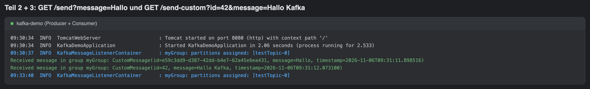
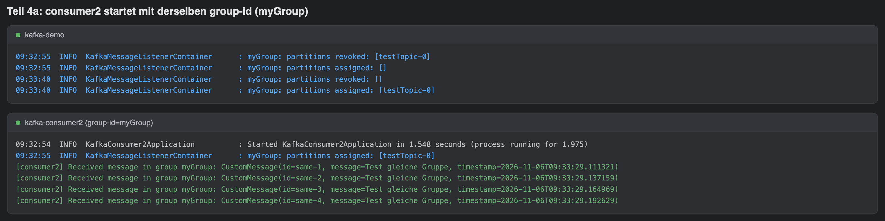
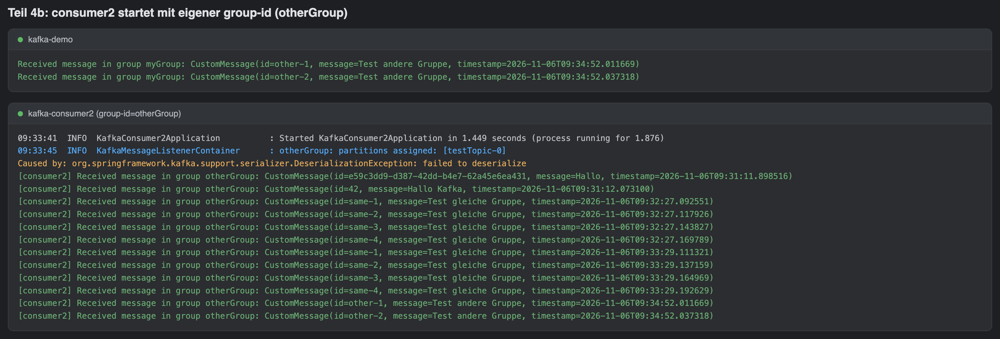

# Kafka mit Spring Boot

Aufgabe 9: Eine Spring-Boot-Anwendung schickt Nachrichten über Apache Kafka und empfängt sie wieder. Kafka läuft lokal in Docker. Zuerst gehen einfache Strings über das Topic, danach strukturierte `CustomMessage`-Objekte als JSON. Ein zweiter, eigenständiger Consumer zeigt, wie sich Consumer Groups verhalten.

```
Browser / Postman
      │  GET /send  ·  GET /send-custom
      ▼
MessageController ──► KafkaProducer ──► Kafka :9092 ──► KafkaConsumer        (kafka-demo)
                                         testTopic  └──► SecondConsumer       (kafka-consumer2)
```

Die Antworten auf die Kontrollfragen stehen in **[KONTROLLFRAGEN.md](KONTROLLFRAGEN.md)**.

## Inhalt

| Ordner / Datei | Inhalt |
| --- | --- |
| [`docker-compose.yml`](docker-compose.yml) | Teil 1: ein Kafka-Broker im KRaft-Modus, ohne Zookeeper |
| [`kafka-demo/`](kafka-demo) | Teil 2 + 3: Producer, Consumer, REST-Controller, `CustomMessage` |
| [`kafka-consumer2/`](kafka-consumer2) | Teil 4: ein eigenständiges Projekt, das nur einen Consumer enthält |
| [`docs/screenshots/`](docs/screenshots) | Konsolenausgaben aller Teile |

```
kafka-demo/src/main/java/ch/kafka/demo
├── KafkaDemoApplication.java
├── controller/MessageController.java   GET /send, GET /send-custom
├── producer/KafkaProducer.java         KafkaTemplate<String, CustomMessage>
├── consumer/KafkaConsumer.java         @KafkaListener(topics = "testTopic")
└── model/CustomMessage.java            id, message, timestamp (Lombok)
```

## Voraussetzungen

- Java 17 oder neuer
- Docker
- Maven ist nicht nötig, denn beide Projekte enthalten den Maven Wrapper (`./mvnw`)

Stack: Spring Boot 4.1, Spring for Apache Kafka 4.1, Spring Web MVC und Lombok.

## Starten

**1. Kafka starten**

```bash
docker compose up -d
docker ps          # der Container apache/kafka:3.9.0 muss laufen
```

**2. Anwendung starten** (oder `KafkaDemoApplication` in IntelliJ ausführen)

```bash
cd kafka-demo
./mvnw spring-boot:run
```

**3. Nachrichten senden**

| Request | Was passiert |
| --- | --- |
| `GET http://localhost:8080/send?message=Hallo` | Sendet `Hallo`, die ID wird als UUID generiert |
| `GET http://localhost:8080/send-custom?id=42&message=Hallo%20Kafka` | Sendet eine `CustomMessage` mit eigener ID und aktuellem Zeitstempel und gibt sie als JSON zurück |

In der Konsole erscheint:

```
Received message in group myGroup: CustomMessage(id=42, message=Hallo Kafka, timestamp=2026-11-06T09:31:12.073100)
```



## Teil 3: JSON-Serialisierung

Kafka transportiert nur Bytes. Damit eine `CustomMessage` über das Topic gehen kann, wandelt der Producer sie in JSON um, und der Consumer baut daraus wieder ein Objekt. Die Konfiguration steht in [`application.properties`](kafka-demo/src/main/resources/application.properties).

> **Hinweis zu Spring Boot 4:** Die Aufgabe nennt `JsonSerializer` und `JsonDeserializer`. Diese Klassen basieren auf Jackson 2. Spring Boot 4 bringt aber Jackson 3 mit, deshalb verwendet dieses Projekt die Nachfolger `JacksonJsonSerializer` und `JacksonJsonDeserializer`. Das Verhalten ist dasselbe.
>
> Zusätzlich steckt der Deserializer in einem `ErrorHandlingDeserializer`. Im Topic liegen nämlich noch die reinen String-Nachrichten aus Teil 2. Ohne diesen Wrapper bliebe ein neuer Consumer an solchen Records hängen. Mit dem Wrapper loggt er sie als Fehler und liest danach weiter.

## Teil 4: Zweiter Consumer

`kafka-consumer2` ist ein eigenes Projekt, das auf start.spring.io neu erstellt und nicht kopiert wurde. Es enthält nur Spring for Apache Kafka, Jackson und Lombok, also keinen Producer und keinen Controller. Da der Producer im Header den Klassennamen `ch.kafka.demo.model.CustomMessage` mitschickt und es diese Klasse hier nicht gibt, ignoriert der Consumer den Type-Header und deserialisiert in seine eigene `CustomMessage`.

```bash
cd kafka-consumer2
./mvnw package -DskipTests

# a) dieselbe Gruppe wie kafka-demo
java -jar target/kafka-consumer2-0.0.1-SNAPSHOT.jar

# b) eine eigene Gruppe
java -jar target/kafka-consumer2-0.0.1-SNAPSHOT.jar --spring.kafka.consumer.group-id=otherGroup
```

### a) Gleiche group-id (`myGroup`)

Startet der zweite Consumer, macht Kafka ein Rebalancing. `testTopic` hat nur eine Partition, deshalb geht sie an `kafka-consumer2`, und `kafka-demo` bekommt `partitions assigned: []`. Jede Nachricht wird nur **einmal** verarbeitet, und zwar vom Consumer, dem die Partition gehört. Beendet man `kafka-consumer2`, übernimmt `kafka-demo` die Partition wieder.



### b) Andere group-id (`otherGroup`)

Beide Consumer bekommen **jede** Nachricht. Weil `otherGroup` neu ist und `auto-offset-reset=earliest` gesetzt ist, liest `kafka-consumer2` zuerst alle alten Nachrichten im Topic nach. Die alte String-Nachricht aus Teil 2 erscheint dabei als `DeserializationException` und wird übersprungen.



## Git-Verlauf

Die Commits folgen den Teilen der Aufgabe. Der erste Commit enthält die String-Version aus Teil 2, der zweite stellt auf `CustomMessage` und JSON um, der dritte ergänzt den zweiten Consumer und die Dokumentation.
